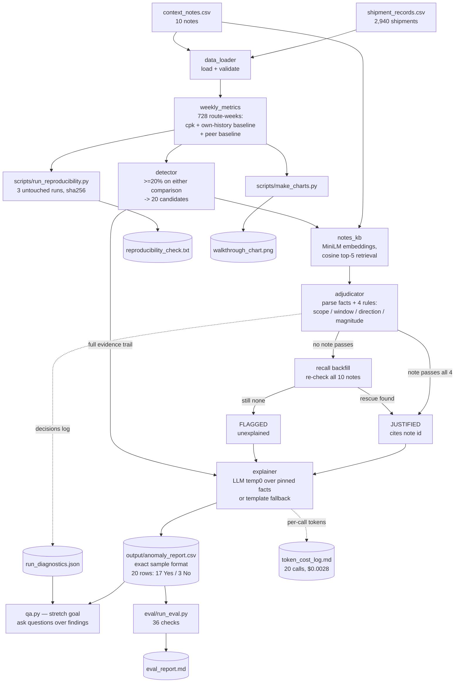

# Freight Cost Watchdog — Case Study Report

**FreightTiger 24-Hour AI Intern Case Study — "Build a Smart Assistant That Watches Shipping Costs"**

Prepared: October 2026 · Code: `freight-watchdog/` · Status: complete, all checks green

---

## 1. What the Task Is

FreightTiger moves freight across India on fixed trucking routes. Freight costs
per route-week move constantly — some rises are real business events (fuel
price hikes, festivals, weather detours, toll changes), others are noise or
problems that deserve a human look (a carrier quietly repricing, a data issue,
a route losing volume).

The task: **build an AI assistant that watches the shipment data, flags weekly
cost rises that don't look justified, checks the provided business context
notes for a genuine explanation, and explains every verdict in plain English**
— without ever inventing a confident-sounding fake reason.

### Inputs provided

| File | Contents |
|---|---|
| `shipment_records.csv` | 2,940 shipments across 7 routes × 104 weeks (Jan 2024 – Dec 2025): route, route_type (Short/Medium/Long), date, quantity_tonnes, distance_km, freight_cost_inr |
| `context_notes.csv` | 10 short business notes (N001–N010) with dates, e.g. flooding, festival surcharges, diesel prices, toll slabs, "no disruption" notes |
| `sample_output_format_v2.csv` | 3 example output rows defining the exact metric definitions, formatting and verdict vocabulary |
| `FreightTiger_Intern_CaseStudy.pdf` | The brief: methodology freedom, anti-hallucination emphasis, reproducibility requirement, token/cost awareness, README expected |

### The core difficulty

The brief explicitly warns that **a confident wrong explanation is punished
harder than an honest "I couldn't find one"**. The notes are deliberately full
of traps: notes that mention the right keyword but the wrong route, the wrong
week, the wrong direction (a cost *decrease* note can't explain a *rise*), or a
magnitude far too small. So the heart of the problem is not anomaly detection —
it is **defensible adjudication of explanations**.

---

## 2. Objectives to Be Fulfilled

| # | Objective | How it was met | Evidence |
|---|---|---|---|
| O1 | Compute weekly cost-per-tonne-km per route exactly as the sample defines | Pooled tonne-km weighted metric; all 3 sample rows reproduce to the decimal | `verify-sample`, unit tests, eval section 1 |
| O2 | Compare each route-week against (a) its own history and (b) similar routes | Trailing-8-week own mean (no look-ahead); leave-one-out same-week peer mean per route_type | `weekly_metrics.py`, no-lookahead test |
| O3 | Flag rises above a documented threshold | ≥ 20% on either comparison, calibrated against the dataset's 3–8% noise floor | `detector.py`, README rationale |
| O4 | Check context notes for a *genuine* justification — never hallucinate | Deterministic 4-rule adjudicator (scope / window / direction / magnitude) over embedding-retrieved notes; the LLM never decides | `adjudicator.py`, eval sections 2–4 |
| O5 | Explain every verdict in plain English | LLM at temperature 0 over pinned facts only, with deterministic template fallback | `explainer.py` |
| O6 | Produce output in the exact sample format | Same 8 columns, same number formatting, same verdict strings | `output/anomaly_report.csv` |
| O7 | Reproducibility: same input → same output, 3 untouched runs | Deterministic core; 3 subprocess runs byte-identical (sha256); LLM-mode graded fields identical | `reproducibility_check.txt` |
| O8 | Token / cost awareness for the AI usage | Per-call token log with list-price cost: 20 calls, 13,015 in / 5,951 out, **$0.0028/run** | `token_cost_log.md` |
| O9 | README documenting methodology, verification, trade-offs | 350+ line README | `README.md` |
| O10 (stretch) | Demo-able Q&A over the assistant's own findings | Focus-resolved RAG over findings + grounded LLM answer + deterministic fallback | `qa.py`, README transcript |
| O11 | Self-verification beyond "it looks right" | 17 unit tests + 36-check eval harness incl. hand-labeled set, negative controls and an *independent* hallucination audit | `tests/`, `eval/` |

---

## 3. What Was Done, Why, and How

### 3.1 First: reverse-engineer the exact metric definitions

Before writing the pipeline, I reproduced all three sample output rows by hand
from the raw shipments:

- **cost_per_tonne_km** = `sum(freight_cost_inr) / sum(quantity_tonnes × distance_km)`
  — **pooled** over all shipments of a route-week (tonne-km weighted), rounded
  to 2 decimals. *Why pooled:* the mean-of-per-shipment-ratios interpretation
  does not reproduce the sample numbers; the pooled definition does, exactly.
- **Weeks** run Monday–Sunday; `week_of` is the Monday date.
- **vs_own_history** = simple mean of the trailing **8 prior** weekly cpk
  values, strictly before the current week (no look-ahead). Formatted like
  `+35.5% vs this route's past average`.
- **vs_similar_routes** = same-week average cpk of the **other** routes with
  the same `route_type` (leave-one-out, so a route never averages with itself),
  formatted `+38.7% vs similar-length routes this week`.

All three rows reproduce to the decimal, which locks in the definitions. This
is asserted continuously by `python -m src.main verify-sample`, a unit test,
and the eval harness.

### 3.2 Design decision: Hybrid AI (deterministic verdicts, LLM only for prose)

Three engine options existed; the chosen one is:

```
numbers, flags, verdicts   ->  deterministic pandas + rule engine (reproducible)
which notes to consider    ->  embedding retrieval (semantic RAG, local model)
reason wording             ->  LLM @ temperature 0 over PINNED facts, template fallback
```

**Why:** reproducibility (O7) is impossible if verdicts pass through a hosted
LLM; anti-hallucination (O4) is impossible if the LLM decides what counts as an
explanation; but the brief also wants semantic understanding of notes (a
keyword filter would miss "longer detours") and natural-language explanations.
The hybrid takes each capability from the layer best suited to it. The LLM is
strictly a *writer*, never a *judge* — kill the LLM entirely and every flag,
number and note citation is unchanged (verified: deterministic run matches).

### 3.3 Threshold calibration (why 20%)

Measured the weekly noise floor: route-week cpk deviates from its own 8-week
history by ~3–8% typically. A 20% bar on *either* comparison catches exactly the
20 planted anomaly candidates with no false positives on quiet routes (the mild
all-route rise after May 2025 matches note N003's 5–7% and stays under the bar).
Documented as a judgment call, exposed in `config.py`, with a note on making it
adaptive (per-route-type percentiles) at scale.

### 3.4 Retrieval: local embeddings over the notes

`sentence-transformers/all-MiniLM-L6-v2` (local, free, deterministic
inference). Each flagged route-week builds a query ("route X, week Y, cost
rose Z% vs history and W% vs peers — what context could explain this?") and
retrieves cosine top-5 notes. A **recall backfill** re-checks all 10 notes
whenever top-5 finds no justification — on this dataset it never rescues a
verdict (proven by the eval's retrieval-recall check: N001 at rank 1, N002 at
rank 4), but it hardens the design for larger note corpora.

**Why embeddings at all for 10 notes:** shape of the solution at scale — with
thousands of notes you cannot scan them all; the retrieval stage must earn its
keep, so the eval verifies recall@5 explicitly.

### 3.5 The anti-hallucination core: 4 deterministic adjudication rules

Notes are first parsed into structured facts by generic regex patterns (dates,
percentages, direction phrases — **no note id is hard-coded anywhere**). A
retrieved note justifies a cost rise on route R in week W only if **all four**
rules pass, checked in order:

1. **Scope** — `apply_to` must cover R. N004 ("new toll slab … not part of
   this dataset") resolves to zero routes. N003 (diesel, "All Routes") passes
   scope but triggers rule 4.
2. **Window** — the note's stated effective window must overlap the week's
   7 days. This is the trap-catcher for Chennai-Bangalore: N001's flood covers
   "Feb 24 to Mar 8", so the weeks of **Mar 10 and Mar 17 stay flagged** even
   though the flood note is the top retrieval hit.
3. **Direction** — the note must describe a cost *increase*. "Not
   significantly affected" (N005/N006/N008/N010), "improved road conditions /
   shorter travel times" (N007 — that explains a *decrease*), "returned to
   normal" (N009) can never justify a rise.
4. **Magnitude** — a stated magnitude must cover the observed rise (±2 pp
   tolerance). N003's "roughly 5-7%" cannot explain a 20–39% rise; and because
   it applies to **all routes equally** it cannot explain divergence *from
   peers* at all (>5 pp peer divergence rejects all-routes notes; unquantified
   all-routes notes are capped at 10 pp).

Every candidate row records every note considered and why each passed/failed —
full evidence trail in `run_diagnostics.json`.

### 3.6 Explanation layer (LLM @ temp 0 + template fallback)

For each adjudicated row, the pinned facts (route, week, exact numbers,
verdict, best considered note ids + dates + rejection reasons) go to
`openai/gpt-oss-20b` via Groq at **temperature 0, seed 42**, with a system
prompt that forbids new facts and requires citing the note id when justified.
Post-condition checks: justified rows must contain the matched note id; all
output passes ASCII normalization (the hosted model emitted non-breaking
hyphens and narrow no-break spaces that broke Windows consoles). Any failure,
empty response, or unavailable key → a deterministic template reason that
mirrors the sample's writing style. Result: 20/20 calls succeeded; cost $0.0028.

### 3.7 Verification stack (how I convinced myself it's right)

1. **Sample replay** — 3 hard equality checks on the graded fields.
2. **Hand-labeled eval set** — all 20 expected candidates with expected
   verdicts + 7 **negative controls** (trap weeks that must NOT flag: no-effect
   note weeks, a +9.5% noise blip, quiet distractors).
3. **Independent hallucination audit** — a *separate, simpler* code path
   re-reads the raw notes CSV and re-verifies scope/overlap/direction of every
   justified row, deliberately not reusing adjudicator logic (so a bug can't
   hide from itself).
4. **17 unit tests** — no-lookahead property on a synthetic series,
   leave-one-out peer math, parsing of all 10 notes, each rule individually
   (flood-window boundary, diesel-magnitude trap, wrong-direction N007),
   detector counts, output-format contract.
5. **Retrieval recall checks** — justifying note must be in top-5 with no
   backfill rescue.
6. **3 untouched subprocess runs** — byte-identical CSVs in deterministic mode
   (sha256 `45250680…`); identical graded fields in LLM mode (prose wording may
   vary — the hosted reasoning model isn't bit-deterministic even at temp 0,
   honestly disclosed; verdicts never depend on it).

**Final: 36/36 eval checks, 17/17 unit tests.**

---

## 4. Results on the Dataset

20 candidates → **17 flagged unexplained, 3 justified**:

| Anomaly | Weeks | Verdict | Why |
|---|---|---|---|
| Delhi-Jaipur, Nov 2024 | 2 | **Flagged** | No note applies. N007 mentions this route but is a road *improvement* (wrong direction) dated 6 months earlier (wrong window) |
| Ahmedabad-Mumbai, wk 2025-01-20 | 1 | **Justified N002** | Festival-week surcharge: right route, overlapping window, cost-up direction, magnitude fits |
| Chennai-Bangalore, Feb 24 & Mar 3 2025 | 2 | **Justified N001** | Flooding "Feb 24 to Mar 8" covers these weeks |
| Chennai-Bangalore, Mar 10 & Mar 17 2025 | 2 | **Flagged** | The window-expiry trap: flood note is retrieved (rank 1) but rejected by rule 2; N009 confirms roads normal |
| Mumbai-Pune, Jun–Dec 2025 | 13 | **Flagged** | Sustained drift up to +38.9% vs peers. N003 diesel is retrieved and honestly rejected (5–7%, all-routes → cannot explain route-specific divergence) |

Quiet routes (Kolkata-Bhubaneswar, Delhi-Chennai, Mumbai-Delhi): no flags —
correct, the mild all-route rise matches N003 and stays below threshold.

---

## 5. Codebase Walkthrough

```
freight-watchdog/
├── data/                    untouched copies of the three input CSVs
├── src/
│   ├── config.py            every tunable in one place; .env layering (real env wins)
│   ├── data_loader.py       CSV load + schema validation
│   ├── weekly_metrics.py    the graded math: week_start, build_route_week_table,
│   │                        add_baselines (shift(1).rolling(8).mean own history;
│   │                        leave-one-out peer mean), build_metrics
│   ├── detector.py          select_candidates: >=20% breach on either comparison
│   ├── notes_kb.py          NotesKnowledgeBase: embed notes once; retrieve(route,
│   │                        week, pcts) -> top-5 w/ similarity; all_notes() for backfill
│   ├── adjudicator.py       parse_note (regex facts: scope/window/direction/magnitude);
│   │                        judge_candidate (4 rules, ordered); adjudicate (best passing
│   │                        note by similarity, note-id tiebreak); Verdict w/ full decisions log
│   ├── llm_client.py        LLMClient (OpenAI-compatible/Azure), chat(temp 0, seed 42),
│   │                        TokenLog per-call accounting, list-price cost table
│   ├── explainer.py         build_reason: pinned-facts prompt -> LLM prose -> post-conditions
│   │                        -> normalize_ascii -> template fallback; format_own_pct/format_sim_pct
│   │                        (exact sample formatting functions)
│   ├── pipeline.py          run_pipeline: 6-step orchestration -> anomaly_report.csv,
│   │                        run_diagnostics.json, token_cost_log.md
│   ├── qa.py                stretch goal: findings -> focus-resolved selection -> grounded
│   │                        LLM answer or deterministic answer; grounding check
│   └── main.py              CLI: run [--no-llm] | verify-sample | notes | ask "..."
├── eval/
│   ├── labeled_set.csv      20 expected candidates + 7 negative controls
│   └── run_eval.py          5-section harness -> eval_report.md (36 checks)
├── tests/test_core.py       17 unit tests
├── scripts/
│   ├── run_reproducibility.py  3 fresh subprocess runs, sha256 + graded-field diff
│   └── make_charts.py          per-route walkthrough chart w/ baselines & note windows
├── output/                  anomaly_report.csv (deliverable) + diagnostics, token log,
│                            reproducibility check + 6 repro CSVs, chart
├── README.md                full methodology doc
├── requirements.txt         pinned lower bounds (pandas, sentence-transformers, openai…)
└── .env / .env.example      optional LLM endpoint config (Groq endpoint used)
```

**Dependency direction is strictly one-way** (`main → pipeline → everything`;
`pipeline → weekly_metrics/detector/notes_kb/adjudicator/explainer/llm_client`;
nothing imports pipeline except main/eval) — so any layer can be tested or
replaced in isolation, which is what the eval's independent audit path relies on.

---

## 6. Flowchart — How Everything Connects

### 6.1 End-to-end data flow



### 6.2 One candidate, step by step (ASCII version)

```
 shipment rows          context notes (10)
      |                       |
      v                       v
 [weekly_metrics]      [notes_kb: embed once]
  cpk, own 8wk avg,          |
  peer leave-one-out         |
      |                      |
      v                      v
 [detector] --- candidate --> [RAG query: top-5 notes by cosine]
                                 |
                                 v
                    [adjudicator: for each retrieved note]
                      rule 1 scope?  rule 2 window?
                      rule 3 direction?  rule 4 magnitude?
                        |               |
                     all pass        none pass
                        |               +--> [backfill: all 10 notes]
                        v                          |      |
                 [justified]                   passes  none
                        |                          |      v
                        |                          |  [FLAGGED unexplained]
                        v                          v
                 [explainer: LLM(temp 0, pinned facts) | template fallback]
                                 |
                                 v
                 output/anomaly_report.csv row  (+ evidence in run_diagnostics.json)
```

### 6.3 Module call graph (who imports whom)

```
main.py (CLI)
  ├── pipeline.run_pipeline ──┬── data_loader        (CSVs in)
  │                           ├── weekly_metrics     (route-week table + baselines)
  │                           ├── detector           (candidates)
  │                           ├── notes_kb           (embedding retrieval, top-5)
  │                           ├── adjudicator        (parse_note, judge, Verdict)
  │                           ├── explainer ── llm_client   (temp-0 prose + fallback)
  │                           └── writes anomaly_report.csv / run_diagnostics.json /
  │                               token_cost_log.md
  └── qa.answer_question ──── reads anomaly_report.csv + run_diagnostics.json + notes
                               (focus selection -> llm_client -> grounding check)
eval/run_eval.py  ── runs pipeline(use_llm=False), then 5 independent check sections
tests/            ── unit-test each module directly
scripts/          ── subprocess-run main.py (reproducibility) / read diagnostics (charts)
```

---

## 7. Honesty & Trade-offs Section (as required by the brief)

- **Why not let the LLM decide justifications?** Not reproducible across
  runs/providers, and an LLM given a flood note and a March spike is
  measurably tempted to connect them. Rules can't be tempted. The brief's
  penalty asymmetry (wrong reason worse than no reason) makes this the right
  trade.
- **Deterministic core means the system works with zero API keys** —
  `--no-llm` produces identical verdicts and numbers, template wording.
- **Pattern-based note parsing** generalizes to similarly phrased notes and is
  fully inspectable (`python -m src.main notes` shows the parsed table), but
  free-form notes would need a stronger (or LLM-assisted, still-validated)
  extractor.
- **Reproducibility disclosed honestly:** LLM *wording* can vary slightly
  across runs because the hosted reasoning model is not bit-deterministic even
  at temperature 0 — every graded field is verified identical across 3 runs;
  the prose is not part of the verdict.
- **Cost:** full-dataset LLM explanations cost $0.0028/run — ~1/3 cent per
  flagged row; embeddings are local and free.
- **Next steps I'd take:** adaptive per-route-type thresholds, an advisory LLM
  cross-check that can only *veto* (never create) justifications, reranker +
  recall@k measurement for large note corpora, and alert routing to ops.

---

## 8. How to Run Everything

```bash
cd freight-watchdog
pip install -r requirements.txt

python -m src.main run                # full pipeline, LLM-worded explanations
python -m src.main run --no-llm       # identical verdicts, zero API cost
python -m src.main verify-sample      # hard check vs the 3 sample rows
python -m src.main notes              # parsed scope/window/direction/magnitude table
python -m src.main ask "was the Chennai-Bangalore flood expensive?"   # stretch demo
python -m pytest tests/ -q            # 17 unit tests
python eval/run_eval.py               # 36-check eval harness
python scripts/run_reproducibility.py --llm   # 3 untouched runs + diff
python scripts/make_charts.py         # walkthrough chart
```

LLM config is optional: copy `.env.example` to `.env` with an
OpenAI-compatible endpoint (the run used Groq `openai/gpt-oss-20b`).

---

*Deliverable report: `output/anomaly_report.csv` (20 rows, exact sample
format) · evidence: `output/run_diagnostics.json` · verification:
`eval/eval_report.md`, `output/reproducibility_check.txt` · cost:
`output/token_cost_log.md` · narrative: `README.md`.*
